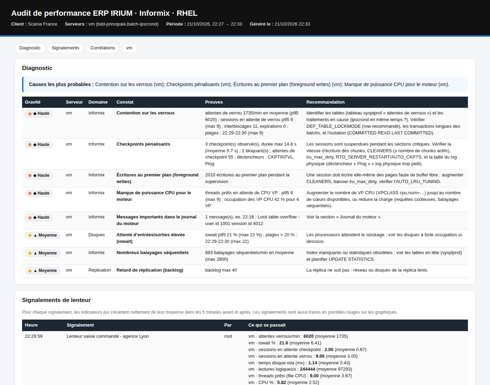

# Scania France : audit des lenteurs ERP IRIUM (Informix / RHEL)

Boîte à outils pour **identifier la source des lenteurs** sur l'infrastructure IRIUM. Une **campagne d'audit** supervise tous les serveurs en même temps et produit **un rapport central unique**, mis à jour pendant la journée :
- l'état de la base Informix ;
- les programmes IRIUM lancés (journal `agr_lds`) ;
- l'état des serveurs.

Les recommandations sont **calculées à partir des mesures** de la campagne et de la configuration relevée (ONCONFIG, noyau…).

| Fichier | Rôle |
|---|---|
| `audit-irium.sh` | Collecte en **lecture seule** sur chaque serveur et pilotage de la campagne (démarrer, état, signalements, rapport, arrêt). Bash, sans dépendance |
| `rapport_audit.py` | Analyse les données de **tous les serveurs** de la campagne et produit le **rapport HTML central** : diagnostic, classements, programmes, plan de recommandations, export CSV. Python 2.7 (RHEL 7) ou 3.6+, sans dépendance |



## Environnement Scania (relevé le 21/10/2026)

| Serveur | Rôle |
|---|---|
| `x0296se` | Base principale Informix `ol_x0296se` (`INFORMIXDIR=/opt/irium/informix`) |
| `x0297se` | Secondaire Informix `ol_x0297se` (type HDR ou RSS relevé par l'audit) |
| serveurs d'applications IRIUM / Genero (fglrun) | Applications : la latence vers la base est mesurée |
| serveur ipscrond | Tâches d'arrière-plan |

La base IRIUM analysée est **`magix_prod`** : profils par objet, statistiques, index et journal des programmes `agr_lds`. Elle peut être changée avec `--base`, et si elle est absente, toutes les bases utilisateur sont analysées. L'environnement Informix est lu dans le profil du compte `informix` (`ONCONFIG=onconfig.ol_x0296se`, `INFORMIXSQLHOSTS=…/sqlhosts.ol_x0296se`). Le journal du moteur `$INFORMIXDIR/tmp/online.log` est au format daté (`MSG_DATE 1`). Une lecture préliminaire de l'ONCONFIG figure dans [docs/analyse-configuration-x0296se.md](docs/analyse-configuration-x0296se.md) : elle donne des hypothèses, que la campagne confirme ou écarte.

## Ce qui est collecté

| Domaine | Contenu |
|---|---|
| **Système & OS** | version RHEL, noyau, uptime, charge, virtualisation (temps « steal »), profil tuned, NTP, paramètres noyau (swappiness, THP, shm, sem), limites du compte informix, erreurs dmesg/journal (I/O, OOM, tâches bloquées), **historique sar des jours précédents** |
| **CPU & mémoire** | utilisateur / système / iowait / steal en continu, charge par CPU, file d'exécution, mémoire disponible, swap in/out, **top 10 des processus** en CPU et en mémoire toutes les 5 min, processus bloqués en état D |
| **Stockage & I/O** | `df -Th`, `df -i`, lsblk, LVM, multipath, planificateur I/O, options de montage ; pour **chaque disque en continu** : occupation %, temps de réponse (await) en lecture et écriture, IOPS, débit ; `iostat -dxk` si sysstat est présent |
| **Réseau** | erreurs d'interface, vitesse et duplex, connexions par port, **retransmissions TCP** ; depuis les serveurs d'applications et ipscrond : **latence (ping et connexion TCP) vers la base** |
| **Informix** | voir le tableau ci-dessous |
| **IRIUM / ipscrond** | nombre de processus IRIUM, **traitements ipscrond en cours** (commande, durée, CPU) pour les relier aux pics de la base |
| **Services supervisés** | processus des services applicatifs (`--services 'digital_dealer|autre'`, `digital_dealer` par défaut), **à chaque relevé** : présence, arrêts, (re)démarrages, CPU réel (% d'un cœur), mémoire, threads, attente d'I/O. Services systemd actifs et **en échec** et ports en écoute, au début et à la fin |
| **Programmes IRIUM (base)** | journal applicatif `agr_lds` sur la base principale : programmes lancés pendant la campagne (et dans l'heure précédente), avec utilisateur, poste, début et fin. Relevé toutes les 5 min, puis relu en fin de campagne pour les dates de fin. Table modifiable avec `--table-programmes` |
| **Pression mémoire du noyau** | compactages et allocations bloquantes, recyclage du cache de pages (Mo/s), fragmentation (`/proc/buddyinfo`), `vm.min_free_kbytes`, THP |

| Commande Informix | Fréquence | Usage |
|---|---|---|
| `onstat -` | chaque relevé | mode du moteur, détection d'un moteur **bloqué** (`Blocked:CKPT/LONGTX…`) |
| `onstat -p` | chaque relevé | cache lecture/écriture, attentes de verrous, interblocages, attentes de checkpoint, balayages séquentiels, bufwaits, débordements (calculés par intervalle, pas en cumul) |
| `onstat -u` | chaque relevé | sessions actives et **sessions en attente par cause** : verrou, buffer, checkpoint, log, mutex |
| `onstat -k` | chaque relevé | nombre de verrous, débordements de la table des verrous |
| `onstat -g rea` | chaque relevé | threads prêts en attente de VP CPU (**saturation CPU du moteur**) |
| `onstat -F` | chaque relevé | écritures au premier plan (manque de buffers propres) |
| `onstat -g glo` | 5 min | occupation réelle des VP CPU |
| `onstat -g ckp`, `-l`, `-g iof`, `-g dri`, `-x`, `-g wai` | 5 min | durée et blocage des checkpoints, logs non sauvegardés, **temps d'I/O par chunk**, réplication HDR (état, backlog), transactions, attentes |
| `onstat -g ses`, `-g sql`, `-g ath`, `-g repl`, `-g rss`, `-g ppf` + requêtes **sysmaster** | 15 min | sessions, SQL en cours, threads ; **sessions et tables les plus coûteuses** (lectures, balayages séquentiels, attentes de verrous) |
| `onstat -g ppf` + `sysptprof` + `syssesprof` (export unload) | 15 min et en fin d'audit | **compteurs par table et par index** : lectures physiques et logiques, lectures ISAM, scans séquentiels, **parcours inverses**, verrous, hit ratio ; **compteurs par session** (utilisateur, poste, PID). Le rapport calcule le cumul depuis le démarrage et le delta sur la fenêtre |
| Inventaire SQL (une fois) | | **remplissage des dbspaces**, taille et nombre d'extents des plus grosses tables, **date des dernières statistiques** (`systables.ustlowts`, `sysdistrib`) de chaque base, rattachement index → table |
| Ouverture des chunks (une fois) | | drapeaux d'ouverture des chunks par les processus `oninit` : **DIRECT_IO réellement actif ou non** (`O_DIRECT`) |
| `onstat -g spi`, `-g ioq`, `-g buf`, `-l` | 5 min | **mode expert** : contention sur les mutex internes (avec interprétation), files d'attente d'I/O AIO/KAIO, écritures premier plan / LRU / chunk par pool, efficacité des buffers de log (pages par écriture), remplissage du log physique ; `-g iof` donne la **vitesse de chaque chunk par intervalle** (Mo/s, IOPS, ms) |
| `syslocks` + `syssessions` | quand ≥ 2 sessions attendent un verrou (au plus toutes les 2 min) | **chaînes de blocage** : session bloquante (utilisateur, poste, PID), tables, sessions bloquées |
| `onstat -d`, `sysscblst` | 15 min | occupation des **dbspaces temporaires**, mémoire des sessions |
| Catalogue de chaque base (une fois) | | verrouillage par page / ligne des tables, taille de ligne, **structure des index** (niveaux, feuilles, colonnes) → tables sans index, index redondants, index profonds ; mode de journalisation des bases ; paramètres **modifiés à chaud** (`onstat -g cfg` comparé à l'ONCONFIG) |
| **Trace SQL** (option `--trace-sql`) | 5 min | `sysadmin:task('set sql tracing on', 3000, '4k', 'low', 'global')` pendant l'audit sur la base principale, **désactivée à la fin** (sauf si SQLTRACE était déjà actif). Top des requêtes **par lectures disque, lectures mémoire, durée, attentes de verrou, exécutions**, avec isolation et texte normalisé : relie les objets coûteux aux requêtes. Seule option qui modifie l'état du moteur (mémoire de trace) |
| Une fois, au démarrage | | `onstat -g seg`, `-g osi`, `-d`, `-D`, `-R`, `-g buf`, `-g ntt`, `-g mgm`, `-g lmx`, `-s`, `-g cluster`, `-c` ; **ONCONFIG complet** ; sqlhosts ; chunks → périphériques ; journal du moteur (MSGPATH) |

**Impact sur la production : négligeable.** Les `onstat` lisent la mémoire partagée sans verrou. Les requêtes SQL ne lisent que sysmaster et le catalogue (`SET ISOLATION TO DIRTY READ`, délai limité). Aucune commande lourde n'est lancée (ni `oncheck`, ni `UPDATE STATISTICS`, ni trace SQL), et rien n'est modifié. `--sans-sql` désactive toutes les requêtes. Chaque commande a un délai maximal.

## Déroulé sur site : campagne d'audit

### Installation (une fois) : un dossier commun à tous les serveurs

1. **Déposer** `audit-irium.sh` et `rapport_audit.py` dans un dossier **partagé** (NFS) monté **au même chemin** sur tous les serveurs, par exemple `/partage/audit-scania/`. Puis `chmod +x audit-irium.sh`.
2. Le compte **root** doit pouvoir écrire dans ce dossier : export NFS en `no_root_squash`, ou dossier en `777` dédié à l'audit. La commande `campagne demarrer` vérifie l'écriture, et refuse de démarrer sinon.
   - Éviter, si possible, un partage hébergé par le serveur de base.
   - De toute façon, chaque serveur collecte **en local** (`/var/tmp/scania-fr`) et copie ses données sur le partage toutes les 5 minutes. Un partage lent ou indisponible ne bloque donc jamais la collecte.
3. **Vérifier l'heure** sur tous les serveurs (`chronyc tracking`) : le rapport aligne les serveurs sur l'heure.
4. **Facultatif** : une clé SSH root depuis le serveur de lancement vers les autres permet de tout démarrer avec une seule commande. Sans SSH, lancer `campagne rejoindre` sur chaque serveur.
5. **Test rapide** : `./audit-irium.sh instantane` sur un serveur (2 minutes).

### Le matin : lancer la campagne

Depuis n'importe quel serveur, en root :
```bash
cd /partage/audit-scania
./audit-irium.sh campagne demarrer scania-22oct --serveurs "x0296se x0297se x0290se x0294se x0295se" \
    --debut 07:30 --duree 5h --intervalle 30 --bdd-hote x0296se --bdd-port sqlexec
```
- Ajouter `--trace-sql` pour obtenir le top des requêtes SQL (recommandé pour la campagne sur la base principale).
- Ajouter `--services 'digital_dealer|nom2|nom3'` pour superviser d'autres services ou processus : le motif est cherché dans la ligne de commande (`ps -ef`).
- Chaque serveur démarre sa collecte en arrière-plan, qui **continue après la déconnexion SSH**. Le rôle de chaque serveur est détecté automatiquement. La latence vers la base n'est mesurée que depuis les autres serveurs.
- Si un serveur n'est pas joignable en SSH, la commande à y lancer est affichée : `./audit-irium.sh campagne rejoindre scania-22oct`.
- **Suivi** : `./audit-irium.sh campagne etat` donne, pour chaque serveur, son rôle, son état (en cours, terminé, silencieux), son dernier relevé et son nombre d'échantillons.
- **Signaler chaque lenteur ressentie, en direct**, depuis n'importe quel serveur :
  ```bash
  ./audit-irium.sh marquer "Lenteur saisie commande - agence Lyon"
  ```
  Les signalements sont centralisés sur le partage. Le rapport montre, pour chacun, ce qui sortait de l'ordinaire à ce moment-là sur tous les serveurs, et **les programmes IRIUM lancés ou en cours**.

### Pendant la journée et l'après-midi : le rapport central

- Le rapport `/partage/audit-scania/campagnes/<nom>/rapport_<nom>.html` est **régénéré toutes les 30 minutes** pendant la campagne. Il est produit par un serveur sans base Informix, pour ne pas charger la base. Ouvert dans un navigateur, il **se recharge seul** tant que la campagne est en cours.
- À la fin, chaque serveur synchronise ses dernières données. Le rapport final est produit dès que tous les serveurs ont terminé.
- **Rapport immédiat** à tout moment, sur données partielles : `./audit-irium.sh campagne rapport`.
- **Arrêt anticipé** de tous les serveurs : `./audit-irium.sh campagne arreter`.
- Le plan d'actions et les classements sont aussi exportés en CSV (Excel) dans `rapport_<nom>_inventaire/`.
- Le rapport fonctionne avec Python 3.6+, y compris celui des Software Collections de RHEL 7 (`rh-python36`, utilisé automatiquement), ou à défaut avec le **Python 2.7 de RHEL 7** (`python`). Si aucun serveur n'a Python, lancer sur le poste de l'auditeur :
  ```bash
  python3 rapport_audit.py /partage/audit-scania/campagnes/<nom>
  ```

Contenu du partage :
```
/partage/audit-scania/
  audit-irium.sh  rapport_audit.py
  campagnes/<nom>/
    campagne.conf            paramètres de la campagne
    <serveur>/               données de chaque serveur (synchronisées toutes les 5 min)
    <serveur>.etat           avancement
    marqueurs.txt            signalements des utilisateurs
    rapport_<nom>.html       RAPPORT CENTRAL
    rapport_<nom>_inventaire/  plan d'actions et classements (CSV)
```
Une archive `.tar.gz` de chaque serveur est aussi conservée localement dans `/var/tmp/scania-fr`. **Volume** : 5 à 20 Mo par serveur pour une matinée.

### Où sont les résultats, et protection du disque

- **Mode autonome** (`instantane`, `supervision`) : `<dossier du script>/resultats/<serveur>/`, par exemple `/msdos/ks/scania-fr/resultats/x0296se/`, avec le rapport HTML et l'archive. Si ce dossier n'est pas accessible en écriture, le script utilise `/var/tmp/scania-fr`. `--sortie DIR` impose un autre dossier.
- **Les rapports sont copiés directement dans le dossier du script** (`/msdos/ks/scania-fr/`) :
  - `rapport_<serveur>_<date>.html` après un audit autonome ;
  - `rapport_<campagne>.html` après une campagne ;
  - `rapport_audit_irium_<date>.html` pour `rapport_audit.py` lancé à la main sans `-o`.

  Chaque rapport est accompagné de son dossier `_inventaire` (CSV).
- **Campagne** : collecte locale dans `/var/tmp/scania-fr`, copiée toutes les 5 minutes dans `<partage>/campagnes/<nom>/<serveur>/`.
- **Protection** : la collecte s'arrête proprement, avec un message dans le journal, s'il reste moins de **1 Go** ou si le disque est plein à plus de **95 %**. Un audit complet d'une matinée fait 5 à 20 Mo par serveur.
- `onstat -g spi` est relevé seulement au début et à la fin, et agrégé à la volée. Sur un gros BUFFERPOOL, il liste un mutex par buffer, soit des millions de lignes.

### Mode autonome (un seul serveur, sans partage)

`./audit-irium.sh supervision --duree 4h [--debut 07:30]`, puis `statut` / `marquer` / `arreter`. Le rapport du serveur est généré en fin d'audit dans son dossier local. Plusieurs archives peuvent ensuite être consolidées avec `python3 rapport_audit.py a.tar.gz b.tar.gz -o rapport.html`.

## Lire le rapport

0. **Campagne** : avancement de chaque serveur (en cours, terminé, silencieux).
1. **Diagnostic** : la liste des constats classés par gravité, avec les preuves chiffrées et la recommandation. Le bandeau du haut résume les causes les plus probables.
2. **Signalements de lenteur** : pour chaque marque, les indicateurs qui s'écartent de leur moyenne à ± 5 minutes, et les programmes IRIUM lancés ou en cours.
3. **Corrélations** : coïncidence minute par minute entre les traitements ipscrond et les verrous, la charge ou le CPU de la base.
4. **Par serveur** :
   - des graphiques alignés sur la même période, où les signalements apparaissent en pointillés rouges ;
   - les processus les plus consommateurs, les traitements ipscrond et les disques ;
   - pour Informix : les paramètres ONCONFIG commentés, les chunks, les VP, la réplication, le journal du moteur et les sorties brutes ;
   - **les programmes IRIUM** : lancements par tranche de 5 minutes, programmes les plus utilisés et les plus longs, et **programmes sur-représentés pendant les pics** de charge ou de verrous de la base (présence pendant les 10 % de relevés les plus chargés, comparée au reste du temps) ;
   - **les objets les plus coûteux** : classement 1 (lectures physiques), 2 (lectures logiques, avec le profil d'accès déduit), 3 (scans séquentiels, avec pages par scan), 4 (parcours inverses d'index), verrous par objet, sessions les plus consommatrices ; remplissage des dbspaces ; ouverture des chunks.
5. **Recommandations**, en fin de rapport : le plan d'actions priorisé. Il regroupe :
   - **Immédiat** : risque d'incident, par exemple un dbspace plein ;
   - **P1** : effet majeur sur la charge ;
   - **P2** et **P3**.

   Chaque action précise sa nature : système, base de données, applicatif ou configuration. La revue de l'**ONCONFIG est croisée avec les mesures**, par exemple :
   - `USELASTCOMMITTED NONE` passe en P1 si une contention sur les verrous a été mesurée ;
   - `DIRECT_IO` est signalé s'il est configuré alors que les chunks ne sont pas ouverts en `O_DIRECT` ;
   - `DS_NONPDQ_QUERY_MEM` est relevé si des tris débordent sur disque ;
   - `OPTCOMPIND 2` est relevé en présence de scans coûteux.

   Le tableau « Mesure de l'efficacité » donne les indicateurs de référence à comparer après chaque correction. Le même plan est exporté en CSV, avec des colonnes de suivi, pour Excel.

Repères utilisés par le diagnostic :

| Indicateur | Normal | Signe d'un problème |
|---|---|---|
| CPU (p95) | < 70 % | > 85 % : saturation ; steal > 5 % : hôte de virtualisation surchargé |
| iowait (p95) | < 5 % | > 15 % : le stockage limite |
| Disque : temps de réponse | < 5 ms (SSD/baie) | > 20 ms, avec occupation > 80 % : goulot d'I/O |
| Swap in/out | 0 | > 0 de façon continue : mémoire insuffisante |
| Cache de lecture Informix | > 98 % (OLTP) | < 95 % : BUFFERPOOL trop petit ou balayages séquentiels |
| Sessions en attente de verrou | 0 à 1 | ≥ 3 de façon répétée : contention (batch pendant la journée ?) |
| Checkpoints | < 2 s, non bloquants | > 10 s ou bloquants : écriture trop lente ou log physique trop petit (déclencheur « Plog ») |
| Écritures au premier plan | 0 | > 0 : CLEANERS / LRU à revoir |
| Threads prêts (`onstat -g rea`) | < nombre de VP CPU | au-delà de façon continue : manque de VP CPU ou de cœurs |
| Latence application → base | < 0,5 ms (même LAN) | > 2 ms : réseau. IRIUM fait de nombreux allers-retours, donc chaque milliseconde compte |
| Réplication HDR synchrone | | Toute lenteur de la réplica ralentit les validations de la base principale |
| Dbspace de données | > 10 % libre | < 5 % : P1 ; < 1 % : **Immédiat** (échec d'allocation d'extents) |
| Lectures physiques par objet | réparties | 2 objets ≥ 30 % des pages lues sur disque : parcours complets répétés |
| Parcours inverses d'index | rares | > 100/s concentrés sur 1 ou 2 index : requêtes « dernière ligne » en boucle |
| Scans séquentiels | petites tables | ≥ 4 000 pages par scan avec ≥ 10^8 pages lues au total : index manquant ; ≥ 0,5 scan/s sur une table moyenne : index sur le critère |
| Index : lectures logiques / lecture ISAM | ≈ 3 | ≥ 2 000 lectures ISAM/s : traitement ligne à ligne (boucle FOREACH) |
| Statistiques de l'optimiseur | < 30 jours | absentes ou anciennes sur une table en tête des classements |
| Pression mémoire du noyau | 0 | compactages > 1/s, allocations bloquantes > 10/s, ou aucun bloc libre > 16 Ko |
| Service supervisé | présent en continu | absent ou redémarré pendant l'audit ; CPU p95 ≥ 80 % d'un cœur ; mémoire en hausse continue |
| Chunk : temps de réponse par intervalle | < 5 ms | p95 > 15 ms : stockage saturé aux heures de pointe |
| File d'I/O du moteur | 0 à 1 | ≥ 4 requêtes en attente (≥ 10 : saturation) |
| Mutex internes | quelques attentes | ≥ 500 attentes/min sur un mutex (lockhash, lrus, logbuf…) |
| Buffer de log logique | plusieurs pages par écriture | < 1,5 page par écriture avec > 20 validations/s : chaque COMMIT attend le disque |
| Session bloquante | aucune | une session bloque ≥ 2 sessions ou sur plusieurs relevés |
| Requête SQL (trace) | coût réparti | une requête ≥ 20 % des lectures disque, du temps ou des attentes de verrou ; ≥ 1 000 exécutions et 20 % du total : boucle |
| Programme pendant les pics | présence comparable | présent dans ≥ 30 % des pics et au moins 1,5 fois plus souvent que le reste du temps |

## Causes fréquentes sur ce type d'architecture

- **Traitements ipscrond lancés en journée** : verrous et cache vidé par des balayages séquentiels. C'est visible dans « Corrélations » et dans la courbe « traitements ipscrond ».
- **HDR en mode synchrone** (`HDR_TXN_SCOPE`, `DRINTERVAL`) avec une réplica dont le disque ou le réseau est plus lent : chaque validation de la base principale l'attend.
- **Checkpoints bloquants** : stockage des chunks lent, log physique trop petit, CLEANERS insuffisants.
- **Index manquants** ou statistiques obsolètes : tables en tête des balayages séquentiels (sysmaster).
- **VM sous-dimensionnée ou hôte surchargé** : temps steal, vCPU partagés.
- **THP activées, swappiness élevé, mémoire partagée non résidente** sur le serveur de base.

## Compléments pour le DBA pendant un incident

Lorsqu'une session précise est lente, en direct :

```bash
onstat -g ses <sid>        # détail de la session : mémoire, threads, SQL
onstat -g sql <sid>        # requête en cours
onstat -u | grep <sid>     # attente en cours (L = verrou, B = buffer, C = checkpoint…)
onstat -k | grep <adresse> # verrou attendu et détenteur
onstat -g stk <tid>        # pile du thread (support IBM/HCL)
```

## Tests

```bash
python3 -m pytest tests
```

L'ensemble a aussi été validé de bout en bout. Le test s'est fait sur un simulateur reproduisant les sorties `onstat` d'Informix 12.10, avec un incident déclenché par un traitement ipscrond. Le diagnostic a bien relevé la contention de verrous, les checkpoints bloquants, les écritures au premier plan et la file d'attente CPU, et les a reliés aux signalements. **À valider** : le format exact des sorties `onstat` sur votre version d'Informix (`onstat -` dans le rapport). Les sorties brutes sont toujours jointes, ce qui permet une relecture manuelle.
