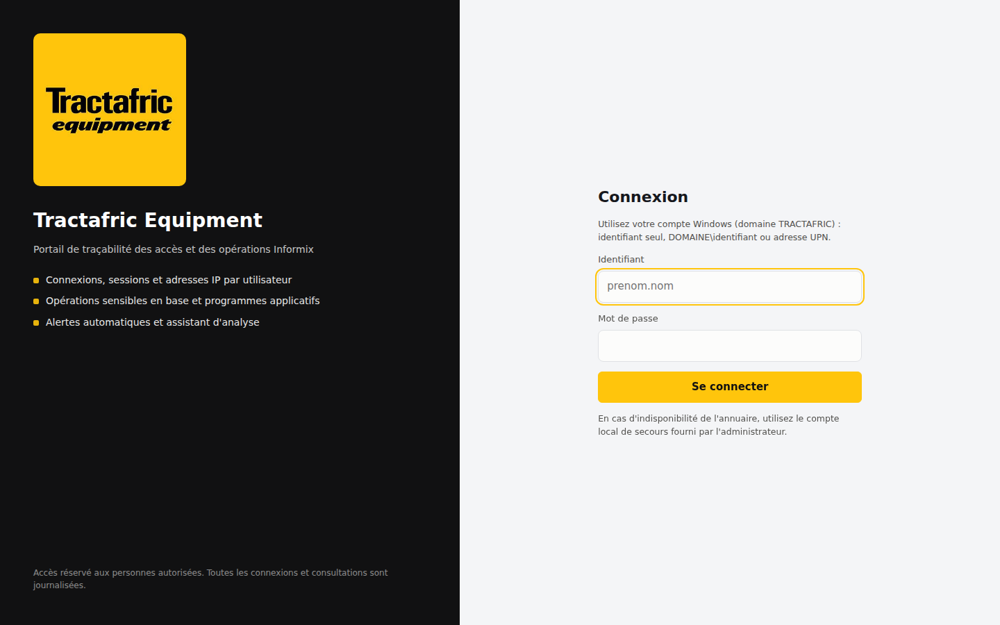
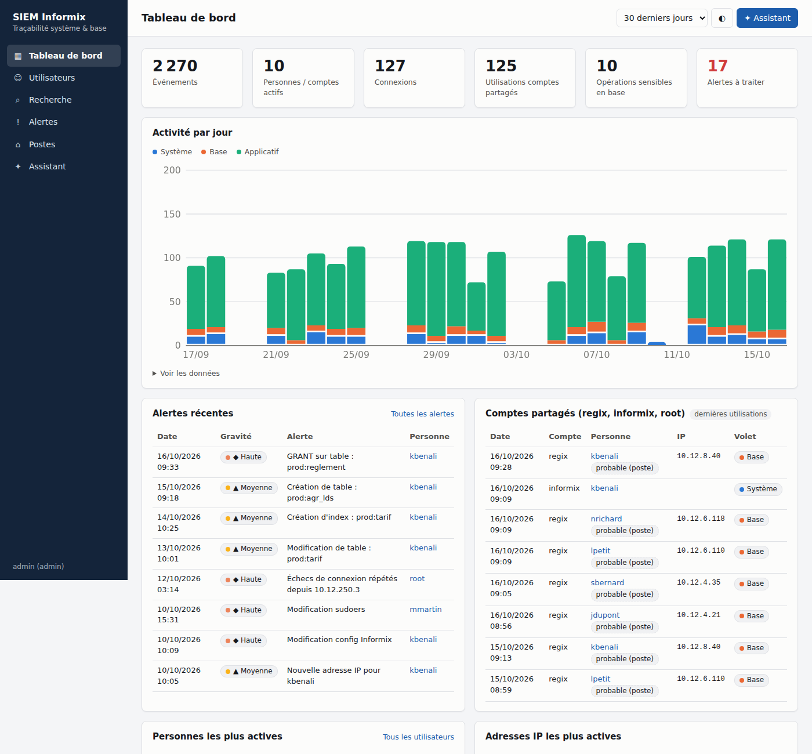
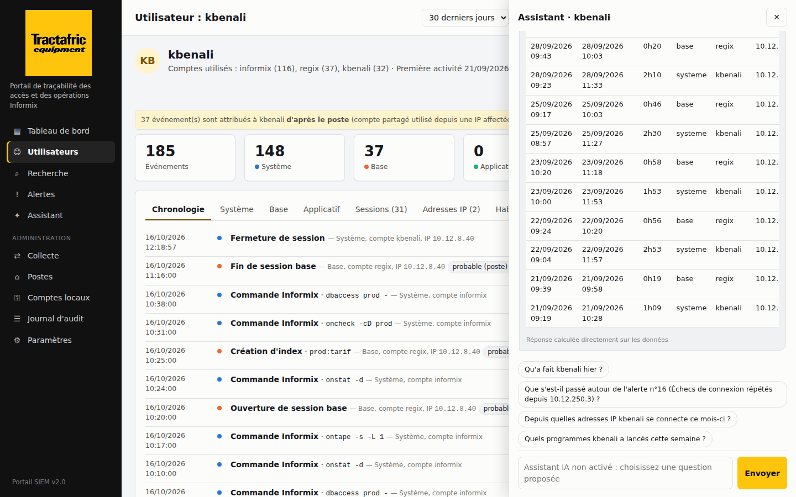

# Portail SIEM Informix

Portail de **traçabilité des accès et des opérations** sur les serveurs de base de données Informix (Red Hat).
Il répond à la question : **qui a fait quoi, quand et depuis où**, y compris quand un compte administrateur partagé
(ex. `regix`) est utilisé par plusieurs collaborateurs.

- **Hébergé sur un serveur isolé** : rien n'est installé en service sur le serveur de base ;
- **Connexion par Active Directory** (groupes AD → rôles), avec un **administrateur local de secours** ;
- **Collecte automatique** toutes les minutes, alertes par e-mail, aux couleurs du client.





## Architecture

```
                     Postes des administrateurs / RSSI (navigateur, HTTPS)
                                        │  Connexion AD (LDAPS) ou compte local de secours
                                        ▼
 ┌──────────────────────── Serveur SIEM isolé (VM dédiée, RHEL ou Docker) ───────────────────────┐
 │  Portail web (FastAPI, HTTPS)  ·  Base d'événements (SQLite)  ·  Planificateur  ·  Alertes      │
 │  Assistant (questions proposées, IA facultative)  ·  Journal d'audit du portail                 │
 └───────────────┬───────────────────────────────────────────────────────┬────────────────────────┘
                 │ SSH sortant, toutes les minutes                         │ LDAPS 636     SMTP 587
                 │ clé ed25519 à COMMANDE FORCÉE                           ▼               ▼
                 ▼                                                   Contrôleurs AD   Messagerie
 ┌──────── Serveur Informix (srv-fr2-107) ────────┐
 │ compte « siemcollect » : ne peut lancer QUE    │   Aucun service ajouté, aucun port ouvert.
 │ sudo platform-python collecteur.py --distant   │   Python système (RHEL 8), rien à installer.
 │ → lit wtmp, btmp, secure, audit.log,            │   La configuration et l'état restent sur le
 │   sysmaster, onshowaudit, table agr_lds         │   portail : rien n'est écrit sur le serveur.
 └────────────────────────────────────────────────┘
```

Pourquoi ce modèle « piloté » plutôt qu'un agent :
- **Le serveur de base reste intact.** Il n'y a ni service, ni port d'écoute, ni dépendance ajoutés ; la désinstallation se fait en une commande.
- **La clé du portail ne donne aucun shell.** L'option `command=` d'`authorized_keys` force le lancement du collecteur, et `sudo` n'autorise que lui. Les options `from=`, `no-pty` et `no-port-forwarding` complètent le verrouillage.
- **Les traces sont copiées hors du serveur toutes les minutes.** Quelqu'un qui utilise regix ne peut pas effacer ce qui a déjà été collecté.

Un mode « poussé » reste disponible (collecteur lancé par cron et envoyant en HTTPS) pour les réseaux où le portail ne peut pas joindre le serveur.

## Fonctions

| Écran | Contenu |
|---|---|
| **Tableau de bord** | État de la collecte de chaque serveur, indicateurs, activité par jour (système, base, applicatif), comptes partagés, alertes, personnes et IP les plus actives |
| **Utilisateurs → fiche** | Chronologie complète ; sessions (connexion, déconnexion, durée, IP, poste) ; adresses IP ; habitudes (carte jour × heure, programmes) ; alertes ; export CSV |
| **Recherche** | Filtres texte, personne, compte, IP, volet, échecs ; export CSV (Excel) |
| **Alertes** | Règles automatiques, gravité, suivi et clôture justifiée, envoi par e-mail des alertes hautes et critiques |
| **Assistant** | Questions proposées selon le contexte (sans IA, aucune donnée envoyée) ; questions libres par IA, facultatives |
| **Administration** | Serveurs collectés (ajout, test, collecte immédiate, reprise d'historique), affectation des postes, comptes locaux de secours, journal d'audit du portail, paramètres |



### Attribution : qui a vraiment agi ?

| Niveau | Cas |
|---|---|
| **certaine** | Compte nominatif, utilisateur applicatif de `agr_lds`, ou utilisateur d'origine d'un `sudo`/`su` (`auid` d'auditd) |
| **probable** | Compte partagé utilisé depuis un poste affecté à une personne (écran *Postes*) |
| **non identifiée** | Compte partagé utilisé depuis un poste inconnu : une alerte est levée |

### Règles d'alerte

| Règle | Gravité |
|---|---|
| Compte partagé utilisé en direct, depuis un poste non affecté ou hors heures ouvrées | moyenne → haute |
| DROP / ALTER / GRANT / REVOKE en base | moyenne → **critique** (suppression la nuit) |
| Modification de `onconfig`, `sqlhosts`, `sudoers`, `/etc/passwd`, `/etc/shadow` | haute |
| 5 échecs de connexion en 10 minutes depuis une même IP | haute |
| Nouvelle adresse IP pour une personne connue | moyenne |
| Connexion hors heures ouvrées | faible |

## Sécurité du portail

- **Accès** :
  - **Active Directory** : LDAPS avec vérification du certificat. Le rôle vient de l'appartenance (même indirecte) à `GG_SIEM_Administrateurs` ou `GG_SIEM_Lecteurs`. Un compte désactivé ou hors groupe est refusé.
  - **Comptes locaux de secours** : empreintes PBKDF2-SHA256. Le dernier administrateur local ne peut pas être supprimé.
- **Sessions** : jeton aléatoire côté serveur, cookie `HttpOnly` / `Secure` / `SameSite=Strict`. Durée maximale 8 h, déconnexion après 30 min d'inactivité. Verrouillage après 5 échecs.
- **Protection du navigateur** : CSP stricte, protection CSRF, anti-iframe, aucune ressource externe. Le portail fonctionne sans Internet.
- **Journal d'audit** : toutes les connexions, consultations de fiches, exports, questions posées à l'assistant et actions d'administration sont tracés.

Détails pour le RSSI : **[docs/securite.md](docs/securite.md)**.

## Tester d'abord sur le serveur de base (sans portail)

**[docs/guide-test-local.md](docs/guide-test-local.md)** explique la mise en place sur le serveur Informix :
- collecte automatique toutes les 5 minutes, avec archive locale ;
- rapports HTML dans `/msdos/ks` (global, par poste IP, par utilisateur) ;
- une seule commande d'installation : `./siem-local.sh installer --base <base>`.

## Installation

Guide complet : **[docs/installation.md](docs/installation.md)**.

```bash
# 1. Serveur SIEM isolé (RHEL 8/9) : paquet hors ligne préparé sur un poste connecté
./deploiement/construire-paquet-hors-ligne.sh 3.11        # sur un poste avec Internet
tar xzf siem-portail-hors-ligne.tar.gz && cd siem-portail  # sur le serveur SIEM
./deploiement/installer-portail.sh                         # en root : service, HTTPS, pare-feu
#    ou avec Docker : cd portail && docker compose up -d

# 2. Serveur Informix : une commande, avec la clé affichée dans Administration > Collecte
./collecteur/preparer-serveur-bdd.sh --cle "ssh-ed25519 AAAA..." --ip-portail 10.20.0.15 --auditd

# 3. Portail : Administration > Collecte > Ajouter un serveur > Tester > Collecter
```

## Démonstration sur un poste

```bash
cd portail && pip install -r requirements.txt
export SIEM_BASE=./donnees/siem.db SIEM_COOKIE_SECURISE=non SIEM_MARQUE_NOM="Tractafric Equipment" \
       SIEM_MARQUE_COULEUR="#FFC50C" SIEM_MARQUE_LOGO=../deploiement/tractafric/logo.png
python -m app.outils demo && python -m app.outils compte admin.local
uvicorn app.main:app --port 8443        # http://localhost:8443
```

## Tests

```bash
pip install pytest httpx fastapi ldap3 anthropic && python -m pytest tests
```

Les tests couvrent :
- les sources (wtmp, secure, auditd, onshowaudit, requête `agr_lds` envoyée à `dbaccess`) ;
- l'ingestion, l'attribution et les alertes ;
- la connexion AD (annuaire simulé : groupes, compte désactivé, compte hors groupe, AD indisponible) ;
- les comptes locaux, le verrouillage, la CSRF et la marque ;
- la collecte pilotée de bout en bout et l'assistant (faux client Claude).

La collecte par SSH à commande forcée a aussi été validée de bout en bout avec un vrai démon SSH et `sudo`. Le test a confirmé qu'une commande arbitraire envoyée avec la clé du portail est remplacée par le collecteur.

## À valider sur l'environnement réel

1. **Colonnes de `agr_lds`** : elles sont détectées automatiquement. À vérifier avec « Tester », puis une collecte.
2. **Format de `onshowaudit`** : il dépend de la version d'Informix. Les positions des champs sont réglables ([docs/informix-audit.md](docs/informix-audit.md)).
3. **Droits base** : le collecteur lance `dbaccess` en root. Pour les sessions et `agr_lds`, il faut `GRANT CONNECT TO root` dans la base, ou un compte dédié.
4. **Flux réseau à ouvrir** : SIEM → Informix (SSH 22), SIEM → contrôleurs AD (636), SIEM → SMTP, postes → SIEM (443).
