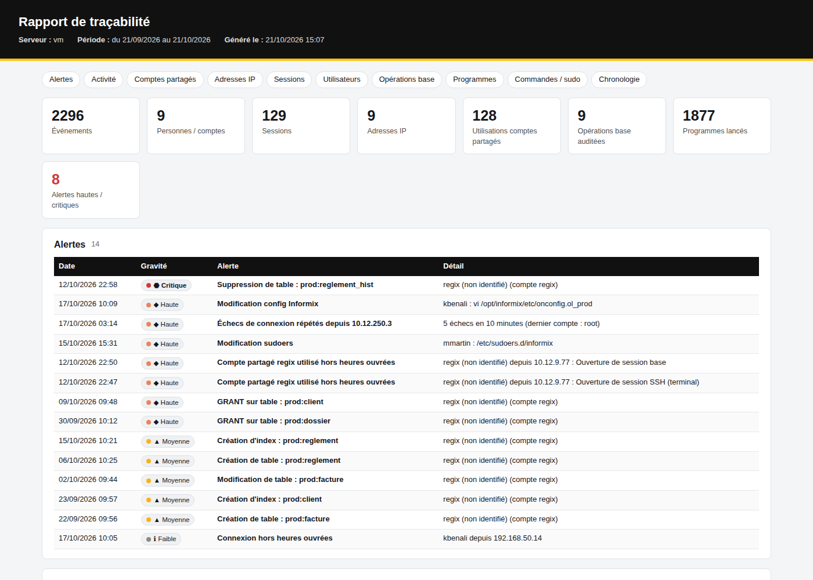

# Guide : mise en place en test sur le serveur de base (mode local, sans portail)

Ce mode sert à tester la solution **directement sur le serveur Informix**, en attendant le portail :

- **collecte automatique toutes les 5 minutes** : connexions, `sudo`/`su`, commandes auditées, sessions et audit Informix, programmes lancés (`agr_lds`) ;
- **archivage local** des événements : l'historique est conservé au-delà de la rotation des journaux (`/var/log/secure` n'est gardé que 4 semaines) ;
- **rapport HTML** généré dans **`/msdos/ks`** : rapport global chaque matin, et rapports à la demande par poste (IP) ou par utilisateur.

Rien n'est envoyé à l'extérieur, aucun port n'est ouvert, aucun paquet n'est installé : seul le Python du système est utilisé.
Quand le portail sera prêt, l'archive constituée pendant le test y sera importée.



---

## 1. Prérequis

| Élément | Vérification |
|---|---|
| Accès root au serveur | `id` doit afficher `uid=0(root)` |
| Python système (RHEL 8) | `ls /usr/libexec/platform-python` (sinon `python3 --version` ≥ 3.6) |
| Compte informix | `su - informix -c 'echo $INFORMIXDIR $INFORMIXSERVER'` |
| Nom de la base qui contient `agr_lds` | demander au DBA, ou `echo "select name from sysdatabases" \| su - informix -c "dbaccess sysmaster -"` |
| Espace disque | quelques Mo par jour dans `/msdos/ks` (`df -h /msdos/ks`) |

---

## 2. Copier les fichiers sur le serveur

Sur votre PC, récupérer le projet :
- **GitHub** : dépôt `khalidsebbane/divers`, branche `claude/blissful-fermi-qhv29b`, **Code → Download ZIP** ;
- puis copier le **contenu** du dossier `siem-informix/collecteur/` dans `/msdos/ks/installation-siem/`, avec WinSCP.

Fichiers nécessaires :

```
collecteur.py        rapport_local.py     rapport_poste.py     siem-local.sh     auditd/
```

Si le serveur a accès à GitHub, on peut aussi récupérer les fichiers directement :

```bash
mkdir -p /msdos/ks/installation-siem && cd /msdos/ks/installation-siem
URL=https://raw.githubusercontent.com/khalidsebbane/divers/claude/blissful-fermi-qhv29b/siem-informix/collecteur
for f in collecteur.py rapport_local.py rapport_poste.py siem-local.sh auditd/siem-informix.rules; do
  mkdir -p "$(dirname $f)"; curl -fsSL -o "$f" "$URL/$f"
done
```

---

## 3. Installer

```bash
cd /msdos/ks/installation-siem
chmod +x siem-local.sh
./siem-local.sh installer --base NOM_DE_LA_BASE --jours 45
```

| Option | Rôle |
|---|---|
| `--base` | base qui contient `agr_lds` (sans elle, le volet applicatif n'est pas collecté) |
| `--jours` | historique repris à la première collecte (45 jours par défaut, dans la limite de ce que gardent les journaux) |
| `--informixdir`, `--informixserver`, `--onconfig` | à préciser seulement si la détection automatique échoue |

Le script affiche 6 étapes :

```
1/6 Python système : /usr/libexec/platform-python
2/6 Programmes installés dans /msdos/ks/siem
3/6 Informix : INFORMIXDIR=/opt/informix INFORMIXSERVER=ol_prod ONCONFIG=onconfig.ol_prod base agr_lds=prod
4/6 Configuration créée : /msdos/ks/siem/collecteur.ini
5/6 Tâche planifiée : /etc/cron.d/siem-local
6/6 Première collecte (reprise de 45 jours d'historique) et premier rapport...
Rapport : /msdos/ks/rapports/siem_global_20260921_20261021.html (... événement(s), ... alerte(s))
```

Organisation après installation :

```
/msdos/ks/
├── rapport-siem.html          ← dernier rapport global (mis à jour chaque matin à 6h30)
├── rapports/                  ← tous les rapports HTML et CSV (global, par poste, par utilisateur)
└── siem/
    ├── collecteur.py, rapport_local.py, rapport_poste.py, siem-local.sh
    ├── collecteur.ini         ← configuration (à vérifier, étape 4)
    ├── postes.csv             ← (facultatif) affectation IP → personne
    ├── donnees/               ← archive : evenements-AAAA-MM.jsonl (à conserver)
    └── var/                   ← état de la collecte, journaux collecte.log et rapport.log
```

---

## 4. Vérifier la première collecte

```bash
/msdos/ks/siem/siem-local.sh statut
```

Dans la sortie de la première collecte, chaque source affiche son nombre d'événements :

| Ligne | Si 0 ou en erreur |
|---|---|
| `wtmp` / `secure` | normal s'il n'y a eu aucune connexion SSH ; sinon vérifier les droits root |
| `auditd` | normal tant que les règles du SIEM ne sont pas installées (étape 6) |
| `sessions` | `No connect permission` / `-387` : voir ci-dessous |
| `applicatif` | `-387` : voir ci-dessous ; `table agr_lds introuvable` : vérifier `--base` |

**Erreur `-387 No connect permission`** : le DBA doit autoriser root sur la base.
```sql
GRANT CONNECT TO root;     -- dans la base qui contient agr_lds
```
Puis relancer : `/msdos/ks/siem/siem-local.sh collecter`.

**Colonnes de `agr_lds`** : le collecteur les détecte seul.
- **Vérifier** : regarder la section *Programmes lancés* du rapport. L'utilisateur et le programme doivent être corrects.
- **Corriger si besoin** : forcer les colonnes dans `/msdos/ks/siem/collecteur.ini`, section `[applicatif]` (`colonne_utilisateur = ...`, `colonne_programme = ...`). La structure exacte s'obtient avec `dbschema -d <base> -t agr_lds`.

---

## 5. Consulter les rapports

Copier `/msdos/ks/rapport-siem.html` sur le PC (WinSCP) et l'ouvrir dans le navigateur. Le fichier est autonome et peut être envoyé par mail ou imprimé en PDF.

| Besoin | Commande (en root) |
|---|---|
| Rapport global des 30 derniers jours | `/msdos/ks/siem/siem-local.sh rapport` |
| Un mois précis | `/msdos/ks/siem/siem-local.sh rapport --depuis 2026-09-01 --jusqua 2026-09-30` |
| **Un poste (adresse IP)** | `/msdos/ks/siem/siem-local.sh rapport --ip 10.12.4.21` |
| Un utilisateur ou un compte | `/msdos/ks/siem/siem-local.sh rapport --utilisateur jdupont` (ou `--utilisateur regix`) |
| **Enquête détaillée sur un poste**, directement dans les journaux du serveur | `/msdos/ks/siem/siem-local.sh poste 10.12.4.21 --depuis 2026-09-21 --nom PC-COMPTA-021` |

Contenu du rapport :
- alertes ;
- activité par jour ;
- utilisation des comptes partagés ;
- adresses IP ;
- sessions (connexion, déconnexion, durée) ;
- fiche par utilisateur ;
- opérations en base ;
- programmes lancés ;
- commandes, `sudo` et `su` ;
- chronologie complète.

Chaque tableau peut être filtré, et un CSV pour Excel est produit à côté.

Les programmes de `agr_lds` sans adresse IP sont **rattachés au poste par le terminal** : même `pts/N` qu'une session SSH ouverte depuis ce poste, à la même heure.

**Attribuer les actions de regix à une personne** : créer `/msdos/ks/siem/postes.csv`. Les lignes correspondantes apparaissent « probable (poste) ».
```
ip;personne;libelle
10.12.4.21;jdupont;PC-COMPTA-021
10.12.8.40;kbenali;PC-DSI-040
```

---

## 6. Compléter la traçabilité (recommandé pendant le test)

### Commandes et fichiers sensibles (auditd)
```bash
id -u informix                                     # uid à reporter dans le fichier
vi /msdos/ks/siem/auditd/siem-informix.rules       # adapter /opt/informix et euid=1001
cp /msdos/ks/siem/auditd/siem-informix.rules /etc/audit/rules.d/
augenrules --load && auditctl -l | grep -c siem    # nombre de règles SIEM actives
```
La source `auditd` est déjà dans la configuration : les commandes apparaissent dès la collecte suivante.

### Opérations en base (audit Informix, avec le DBA)
Suivre [informix-audit.md](informix-audit.md), puis, dans `/msdos/ks/siem/collecteur.ini` :
```ini
[collecteur]
sources = wtmp,btmp,secure,auditd,sessions,applicatif,onaudit
[informix]
commande_onshowaudit = onshowaudit -n ol_prod
```
Vérifier le format avec `onshowaudit -n ol_prod | head -3`, comparé au modèle décrit dans le guide d'audit.

**Sans audit Informix, les ordres SQL (SELECT, UPDATE, DELETE…) ne sont pas conservés.** C'est la seule source qui trace les opérations en base poste par poste.

---

## 7. Fonctionnement automatique

`/etc/cron.d/siem-local` :
```
*/5 * * * * root /msdos/ks/siem/siem-local.sh collecter     # collecte (une seule à la fois)
30 6 * * * root /msdos/ks/siem/siem-local.sh rapport         # rapport global du matin
```
- Journaux : `/msdos/ks/siem/var/collecte.log` et `rapport.log`.
- Chaque passe reprend là où la précédente s'est arrêtée, sans doublon.
- L'archive est découpée par mois (`evenements-2026-10.jsonl`, …).
- Contrôle rapide : `tail -f /msdos/ks/siem/var/collecte.log`.

---

## 8. Passage au portail

Le jour où le portail est installé ([installation.md](installation.md)) :
1. **Importer l'archive du test** :
   `python -m app.outils importer evenements-2026-10.jsonl`, pour chaque fichier.
   L'historique du test est conservé et les doublons sont ignorés.
2. **Préparer le serveur pour la collecte pilotée** : `preparer-serveur-bdd.sh`.
3. **Retirer le mode local** : `/msdos/ks/siem/siem-local.sh desinstaller`. L'archive est conservée.

## 9. Désinstallation

```bash
/msdos/ks/siem/siem-local.sh desinstaller           # arrête la collecte, garde l'archive et les rapports
/msdos/ks/siem/siem-local.sh desinstaller --tout    # supprime aussi /msdos/ks/siem et /msdos/ks/rapports
rm -f /etc/audit/rules.d/siem-informix.rules && augenrules --load   # si les règles auditd ont été installées
```

## Points d'attention

- **Données personnelles** : l'archive et les rapports contiennent des identifiants, adresses IP et horaires. Il faut restreindre l'accès à `/msdos/ks` (`chmod 750`) et en informer le client (RGPD).
- **Charge** : la collecte dure quelques secondes toutes les 5 minutes. Le volet `agr_lds` ne lit que les nouvelles lignes.
- **Compte regix partagé** : tant que son mot de passe est partagé, l'attribution reste « probable » (via `postes.csv`) ou « non identifiée ».
