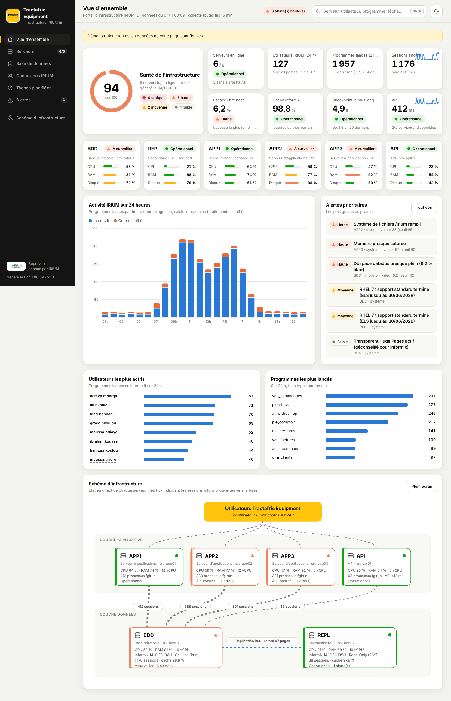
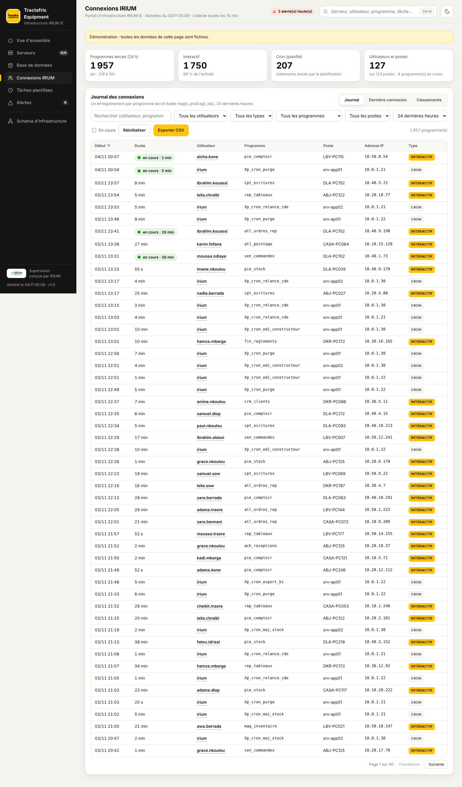
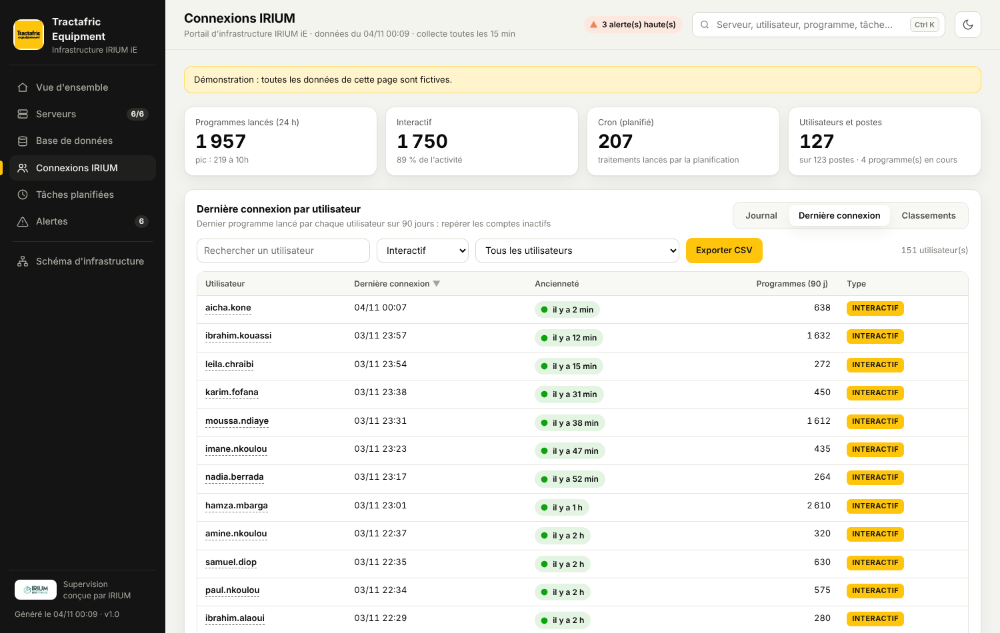
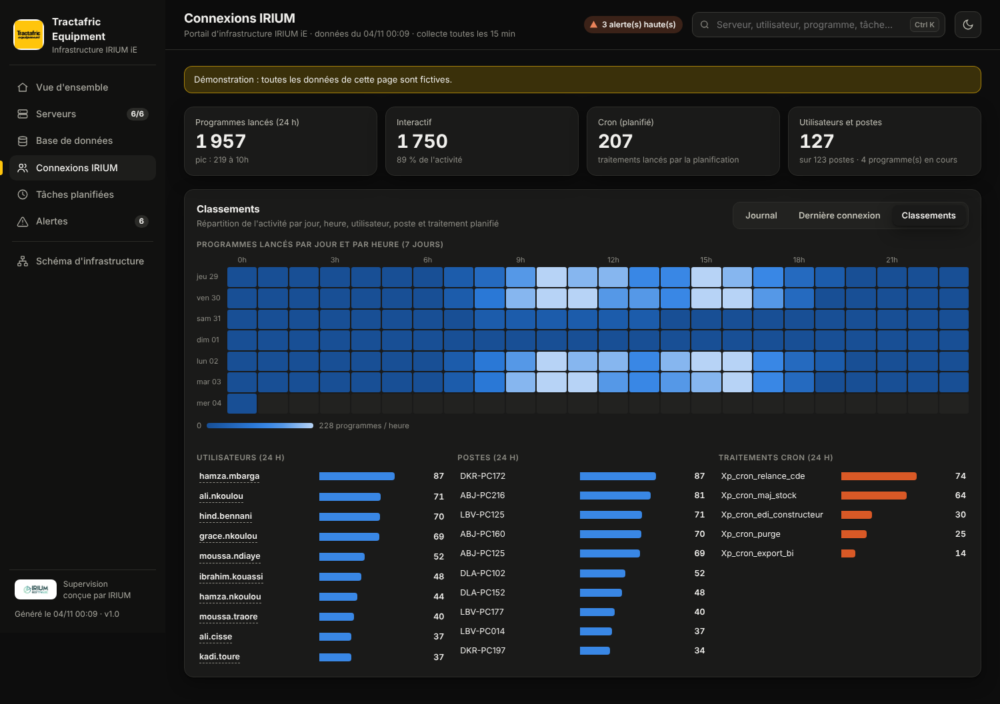
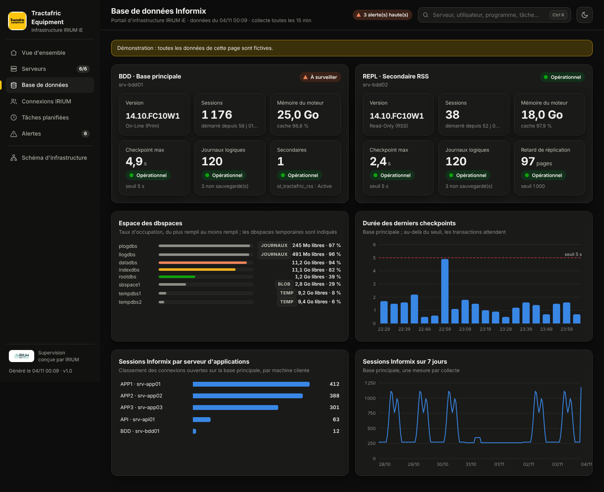
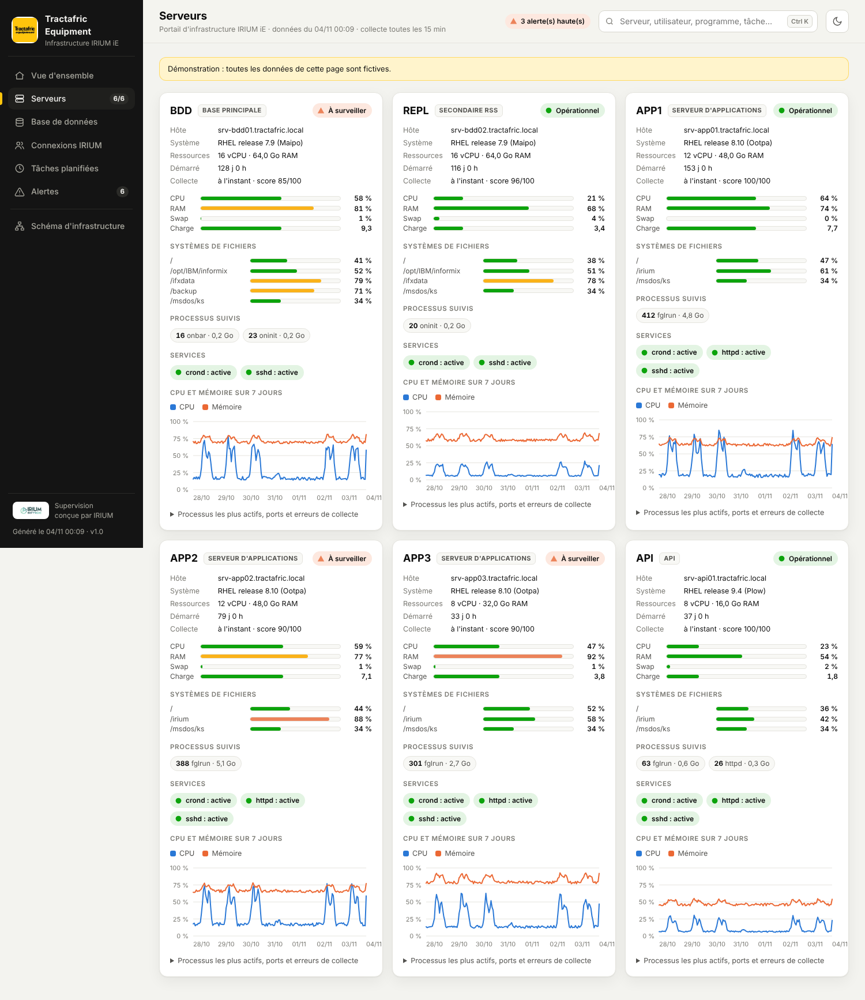
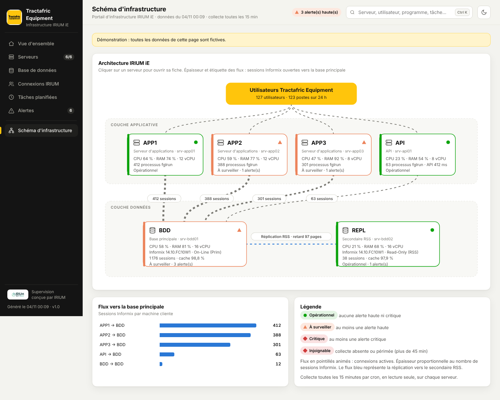
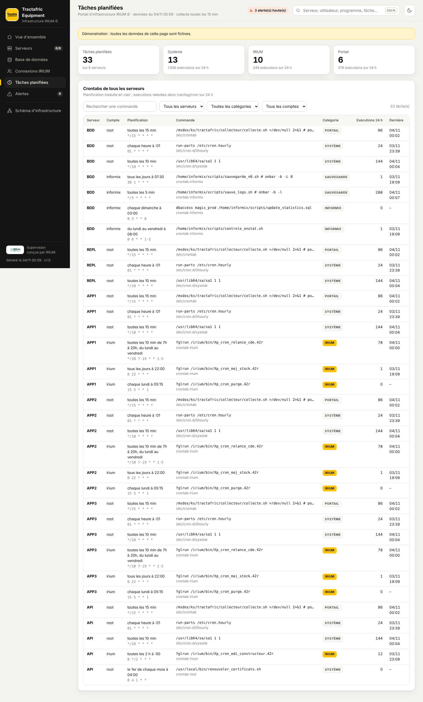
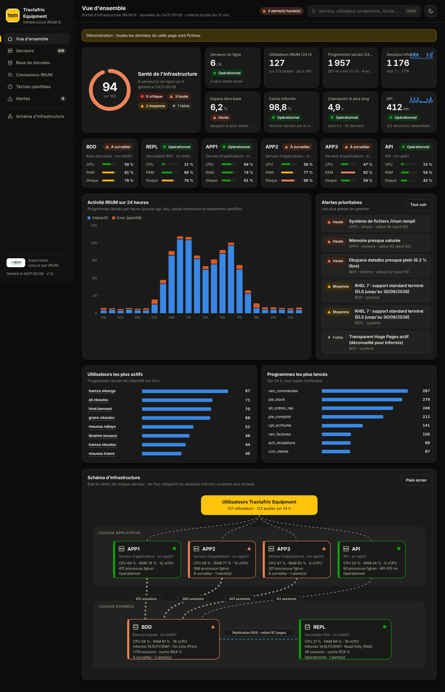

# Portail d'infrastructure IRIUM iE — Tractafric

Portail web destiné à la DSI. Il montre en un coup d'œil l'état de toute l'infrastructure IRIUM iE :
- serveurs **BDD**, **REPL**, **APP1**, **APP2**, **APP3** et **API** ;
- moteur Informix et réplication ;
- connexions des utilisateurs IRIUM (journal `agr_lds`), classées **interactif** ou **cron** ;
- tâches planifiées de chaque serveur ;
- alertes ;
- **schéma d'infrastructure en direct**.

La collecte passe par cron, toutes les 15 minutes, en lecture seule sur chaque serveur. Le portail est une **page unique et autonome** : aucune ressource externe, aucun code exécuté côté serveur, il fonctionne sans Internet.



## Écrans

| Écran | Contenu |
|---|---|
| **Vue d'ensemble** | Score de santé sur 100, 8 indicateurs, état de chaque serveur, activité IRIUM heure par heure, alertes prioritaires, classements des utilisateurs et des programmes, schéma d'infrastructure |
| **Serveurs** | Fiche par serveur : OS, vCPU, RAM, CPU, mémoire, swap, charge, systèmes de fichiers, processus IRIUM (`fglrun`…), services, ports, courbes CPU et mémoire sur 7 jours |
| **Base de données** | Primaire et secondaire RSS : version, mode, sessions, mémoire, cache, checkpoints, journaux logiques non sauvegardés, retard de réplication, dbspaces, **sessions par serveur d'applications** |
| **Connexions IRIUM** | **Journal** filtrable (texte, utilisateur, type, programme, poste, période, en cours) avec tri, pagination et export CSV ; **dernière connexion** par utilisateur, avec repérage des comptes inactifs depuis plus de 7 ou 30 jours ; **classements** : carte jour × heure sur 7 jours, utilisateurs, postes, traitements cron |
| **Tâches planifiées** | Crontabs de tous les serveurs, planification traduite en clair, catégorie (IRIUM, Informix, Sauvegarde, Système), exécutions relevées sur 24 h |
| **Alertes** | Filtre par gravité et par serveur, valeur mesurée et seuil |
| **Schéma d'infrastructure** | Utilisateurs → serveurs d'applications et API → base principale → secondaire RSS. Couleur des serveurs selon leur état ; flux animés proportionnels aux sessions ; un clic ouvre la fiche du serveur |

Autres fonctions :
- **Recherche globale** (`Ctrl K`) sur les serveurs, utilisateurs, programmes, postes, tâches et alertes ;
- thèmes clair et sombre ;
- affichage adapté au mobile ;
- rechargement automatique toutes les 5 minutes, sur la vue en cours.

| | |
|---|---|
|  |  |
|  |  |
|  |  |
|  |  |

## Architecture

```
      cron */15 sur chaque serveur (root, lecture seule)
 BDD ─┐  REPL ─┐  APP1 ─┐  APP2 ─┐  APP3 ─┐  API ─┐
      ▼        ▼        ▼        ▼        ▼       ▼
   collecte_infra.py → <PARTAGE>/donnees/<NOM>/dernier.json + historique.jsonl (7 jours)
                                      │   partage NFS commun (ex. /msdos/ks/tractafric)
                                      ▼
   serveur GENERATEUR : generer_portail.py → <PARTAGE>/portail/index.html
                                      │
                                      ▼
   Apache httpd en HTTPS + authentification AD (groupe GG_Portail_Infra) → navigateur de la DSI
```

| Source | Ce qui est relevé |
|---|---|
| Système | `/proc` (CPU, mémoire, swap, charge, THP), `df`, `ps` (processus suivis), `systemctl is-active`, `ss`, `who` |
| Cron | `/etc/crontab`, `/etc/cron.d/*`, `/var/spool/cron/*`, `crontab -l -u` ; exécutions lues dans `/var/log/cron` |
| Informix (BDD, REPL) | `onstat -`, `-p`, `-g ckp`, `-l`, `-g rss verbose` ; `sysmaster` (sessions par hôte et par compte, dbspaces) |
| IRIUM (BDD) | Table `agr_lds` (colonnes détectées automatiquement). Classement **cron** si le complément correspond à `Xp_cron*` ou si le compte ou le poste est déclaré comme planificateur. Détail sur 24 h, agrégats horaires sur 7 jours, dernière connexion sur 90 jours |
| API | Code HTTP et temps de réponse des URL déclarées |

Toutes les requêtes SQL sont en `DIRTY READ`, avec un délai d'attente. Un verrou (`flock`) empêche deux collectes simultanées. Le journal de collecte est limité à 5 Mo.

## Installation

Deux modes, au choix (`MODE` dans `tractafric.conf`) :

| Mode | Principe | Quand l'utiliser |
|---|---|---|
| **central** (recommandé) | Un seul serveur, par exemple **REPL**, porte le portail et le cron. Il interroge les autres en SSH avec une clé **à commande forcée** : sur chaque serveur, elle ne peut lancer que le collecteur | Les serveurs se joignent en SSH ; aucun partage commun |
| **partage** | Chaque serveur a son cron et écrit dans un dossier NFS commun | Un partage NFS existe déjà sur tous les serveurs |

### Mode central (depuis REPL)

```
            REPL (central) : cron */15 → collecte_centrale.py → portail/index.html
              │ SSH, clé ed25519 portail-infra, en parallèle
   ┌──────────┼──────────┬──────────┬──────────┐
   ▼          ▼          ▼          ▼          ▼
  BDD        APP1       APP2       APP3       API
  authorized_keys : from="IP de REPL",command="python …/collecte_infra.py --stdout --nom APP1 --role app",no-pty…
  → la clé ne donne aucun shell : quelle que soit la commande envoyée, seul le collecteur s'exécute
```

Prérequis :
- REPL joint chaque serveur en SSH (port 22) ;
- un compte d'administration permet de déployer une seule fois sur chaque serveur : root, ou un compte avec sudo ;
- les serveurs interrogés ont Python (`platform-python` ou `python3` sur RHEL 8 et 9, `python` 2.7 sur RHEL 7).

```bash
# Sur REPL, en root
mkdir -p /msdos/ks && cd /msdos/ks
git clone -b claude/blissful-fermi-qhv29b https://github.com/khalidsebbane/divers.git && cp -r divers/tractafric . && rm -rf divers
cd /msdos/ks/tractafric
cp tractafric.conf.exemple tractafric.conf && vi tractafric.conf
#   MODE=central  CENTRAL=REPL  SERVEURS="BDD:hote:bdd:IP REPL:hote:repl:IP APP1:hote:app:IP ..."
#   INFORMIXDIR / INFORMIXSERVER (INFORMIXSERVER_REPL=... si l'instance du secondaire a un autre nom), BASE=..., URLS_API=...

./collecteur/deployer-ssh.sh            # clé du portail, collecteur dans /opt/portail-infra sur chaque serveur, test
                                        # (ADMIN=compte ./collecteur/deployer-ssh.sh si root n'a pas d'accès SSH direct)
./collecteur/installer-cron.sh --tester # collecte de tous les serveurs + génération du portail
./collecteur/installer-cron.sh          # cron toutes les 15 minutes, sur REPL uniquement
```

Le déploiement affiche l'empreinte SSH de chaque serveur, à comparer, puis termine par un bilan `OK` ou `ÉCHEC` par serveur.

Points à vérifier :
- **Root sans connexion SSH** (`PermitRootLogin no`) : mettre `PermitRootLogin forced-commands-only`. Root n'est alors accepté que par une clé à commande forcée. Autre solution : `COMPTE_SSH=un_compte`, auquel cas le déploiement crée la règle sudo limitée au collecteur.
- **Ajouter un serveur ou mettre à jour le collecteur** : `./collecteur/deployer-ssh.sh APP3`.
- **Tout retirer** : `./collecteur/deployer-ssh.sh --desinstaller`, puis `./collecteur/installer-cron.sh --retirer`.

### Ouvrir le portail

Le fichier `<PARTAGE>/portail/index.html` (par exemple `/msdos/ks/tractafric/portail/index.html` sur REPL) est autonome. Il s'ouvre **directement dans un navigateur**, sans serveur web :
- **sur REPL, s'il a une interface graphique** : `firefox /msdos/ks/tractafric/portail/index.html` ;
- **depuis un poste Windows** :
  - si `/msdos/ks` est un partage Windows monté sur REPL, ouvrir le fichier par ce partage ;
  - sinon, le récupérer avec WinSCP : `scp root@REPL:/msdos/ks/tractafric/portail/index.html .` ;
- **en accès permanent pour la DSI** : Apache en HTTPS avec authentification AD (voir plus bas). Le fichier contient des noms d'utilisateurs et des adresses IP : ne pas le publier sans authentification.

### Mode partage (NFS)

```bash
# 1. Une seule fois : déposer le dossier sur le partage et adapter la configuration (MODE=partage, GENERATEUR=...)
cp tractafric.conf.exemple tractafric.conf && vi tractafric.conf
# 2. Sur chaque serveur, en root
/msdos/ks/tractafric/collecteur/installer-cron.sh --tester && /msdos/ks/tractafric/collecteur/installer-cron.sh
```

### Publication Apache (facultatif)

Sur le serveur qui porte le portail :

```bash
cp deploiement/portail-infra.conf /etc/httpd/conf.d/ && vi /etc/httpd/conf.d/portail-infra.conf
apachectl configtest && systemctl reload httpd                 # https://portail-infra.tractafric.local:8443
```

Génération manuelle du portail : `python3 portail/generer_portail.py --conf tractafric.conf`.

### Seuils d'alerte

Ils se règlent dans `tractafric.conf` :

| Paramètre | Défaut | Règle |
|---|---|---|
| `SEUIL_CPU` / `SEUIL_MEMOIRE` | 85 / 90 % | Processeur ou mémoire saturés |
| `SEUIL_DISQUE` | 85 % | Système de fichiers rempli (critique à 95 %) |
| `SEUIL_DBSPACE_LIBRE` | 10 % | Dbspace de données presque plein (critique sous 2 %). Ne s'applique pas aux dbspaces temporaires, de journaux ou de smart blobs |
| `SEUIL_CHECKPOINT_S` | 5 s | Checkpoint long (haute au double du seuil) |
| `SEUIL_RETARD_RSS` | 1000 pages | Retard de réplication |
| `SEUIL_API_MS` | 2000 ms | API lente (indisponible : critique) |
| `FRAICHEUR_MAX_MIN` | 45 min | Pas de collecte récente : serveur injoignable |

Alertes également levées :
- service arrêté ;
- moteur Informix arrêté ou dans un mode inattendu ;
- secondaire RSS non actif ;
- plus de la moitié des journaux logiques non sauvegardés ;
- swap au-delà de 20 % ;
- charge supérieure à 2 × le nombre de vCPU ;
- RHEL 7 (fin du support standard) ;
- THP actif sur un serveur Informix ;
- collecte partielle.

## Démonstration

```bash
python3 portail/generer_portail.py --demo        # -> demo/index.html, données fictives (exemple prêt à ouvrir : docs/portail-demo.html)
```

## Tests

```bash
python3 -m pytest tests
```

Les tests couvrent :
- l'analyse des sorties `onstat`, `/proc`, `df`, crontab et `/var/log/cron` ;
- le format unload ;
- la détection des colonnes de `agr_lds` et l'expression SQL de classement cron ;
- la traduction des planifications ;
- les règles d'alerte ;
- la génération complète du portail ;
- l'échappement du contenu ;
- la collecte centrale avec un SSH simulé : serveur local, serveur distant, serveur injoignable et nom de serveur incohérent ;
- la sortie ASCII sous `LANG=C`.

La compilation en Python 2.7 est testée quand Python 2.7 est présent.
